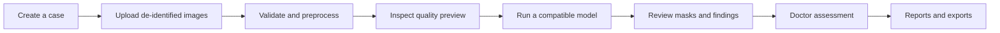
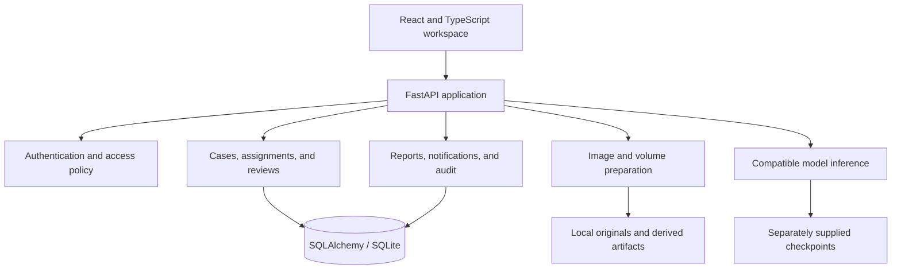

<div align="center">


# CoroVision AI

### From angiography to evidence. From evidence to expert review.

A research workspace for coronary artery segmentation, vessel exploration, and suspected stenosis localization.

**Infosys Springboard · Team 2**

`React + TypeScript` · `FastAPI` · `Medical imaging` · `Deep learning`

[Get started](#get-started) · [Workflow](#the-workflow) · [Architecture](#architecture) · [Documentation](#documentation) · [Research results](reports/latest_measured_training_results.md)

</div>

---

> **Research prototype—not a medical device.** AI masks and measurements support research and expert review. They are not a diagnosis, a validated stenosis grade, or a substitute for medical advice. Use only public or appropriately de-identified data.

## Why CoroVision?

Medical-image research needs more than a prediction: reproducible preparation, preserved source images, traceable results, and a clear separation between AI output and human assessment.

CoroVision brings these steps into one role-based application: create a case, prepare images, inspect available model outputs, record a doctor's review, and export permitted reports.

## What you can do

| Capability | In the application |
| :--- | :--- |
| **Manage studies** | Create de-identified cases, record metadata, select intended tasks, and assign case access. |
| **Prepare images** | Validate supported images, select DICOM frames or PDF pages, apply optional ROI cropping, and generate previews. |
| **Choose preprocessing** | Standard only, noise reduction, contrast enhancement, or both enhancements together. Originals and processing records are retained. |
| **Explore AI findings** | Inspect artery and suspected stenosis overlays when compatible checkpoints are installed. Review vessel measurements with calibration limitations. |
| **Record expert review** | Enter a doctor's decision, assessed severity, notes, and follow-up findings separately from predictions. |
| **Track and report** | Inspect saved analysis history, report revisions, notifications, and authorized exports. |
| **Control access** | Use role-specific workspaces. Case ownership and assignment still apply. |

## The workflow



**The original is retained.** Preparation creates a derived image; it does not overwrite the source or start training. Final report approval remains a separately authorized action.

### Imaging scope

| Input | Current scope |
| :--- | :--- |
| **Coronary X-ray angiography** | 2D preparation and compatible artery/stenosis-mask inference. |
| **CT, CTA, and MRA** | Separate research volume preparation and exports; no connected volume-inference model is implied. |
| **DICOM and scanned PDFs** | Supported decoding, frame/page selection, validation, and preparation within documented limits. |

X-ray images and CT/MR volumes use separate processing routes. This project does **not** provide complete whole-body artery segmentation or validated automated clinical grading.

## Workspaces built around responsibilities

| Role | Main responsibility |
| :--- | :--- |
| **Doctor** | Review authorized cases, images, findings, severity assessments, and reports. |
| **Medical Researcher** | Prepare research cases, explore outputs, and inspect recorded evaluations. |
| **Technician / Data Operator** | Handle intake, uploads, metadata, and preparation quality. |
| **ML Engineer** | Inspect model records and evaluation artifacts; training controls are not connected. |
| **Viewer** | Read shared case details, recorded results, and assigned doctor information. |
| **Administrator** | Manage users, access, audit records, and available doctor workflows within case scope. |

Legacy `clinician` identifiers remain supported internally; the interface presents the role as **Doctor**. Institutional SSO requires a real identity-provider configuration—not a demo account name.

## Architecture



SQLite is the local default. PostgreSQL can be configured through `DATABASE_URL`; production use requires additional security, operations, and privacy review.

## Get started

**Trained models:** download the [276 MB artery and stenosis model ZIP](https://github.com/springboardmentor01092s-tech/Team_2_Artery-Segmentation-DL/releases/download/corovision-mask-models-v1/CoroVision_application_mask_models_v1.zip)
from the [model release](https://github.com/springboardmentor01092s-tech/Team_2_Artery-Segmentation-DL/releases/tag/corovision-mask-models-v1).
Use the `lingareddy-dhanush` source branch and follow the
[model installation steps](docs/FRESH_CLONE_SETUP.md#install-trained-models). Weights are a separate
release download; cloning alone does not install them.

**Recommended for a new laptop:** follow the [fresh-clone guide](docs/FRESH_CLONE_SETUP.md), or run these commands from the cloned repository root:

```bash
python scripts/setup_local.py
python scripts/run_local.py
```

Then open **http://127.0.0.1:8000**. This serves the built application and API together. The scripts create private configuration and storage locally; use `python3` instead of `python` if required. Optional models, PDF conversion, and account setup are covered in the guide. The separate-server development setup is shown below.

**Requirements:** Python 3.11–3.13, Node.js 20+, and npm. Scanned PDF conversion also requires Poppler's `pdftoppm`. Optional inference dependencies are in `backend/requirements-ai.txt`.

### 1 · Clone the working branch

```bash
git clone --branch lingareddy-dhanush https://github.com/springboardmentor01092s-tech/Team_2_Artery-Segmentation-DL.git
cd Team_2_Artery-Segmentation-DL
```

### 2 · Start the backend

```bash
cd backend
python3 -m venv .venv
source .venv/bin/activate
pip install -r requirements.txt
export JWT_SECRET="$(python3 -c 'import secrets; print(secrets.token_urlsafe(48))')"
uvicorn app.main:app --reload --host 127.0.0.1 --port 8000
```

On Windows, activate with `.venv\Scripts\activate`. Keep your JWT secret stable in private environment configuration for persistent sessions; generating a new value invalidates previous tokens.

### 3 · Start the frontend

Open another terminal at the repository root:

```bash
cd frontend
npm ci
npm run dev -- --host 127.0.0.1
```

| Open | Address |
| :--- | :--- |
| Application | <http://127.0.0.1:5173> |
| Interactive API documentation | <http://127.0.0.1:8000/docs> |

Keep both servers running. Opening `frontend/index.html` directly does not launch the application.

### 4 · Set up an account

Use registration for the default research account workflow. To bootstrap an administrator, set `ADMIN_EMAIL` and `ADMIN_PASSWORD` privately, then run `python create_admin.py` from `backend/`. The password must contain at least 12 characters.

Never commit credentials. See [authentication setup](docs/AUTH_SETUP.md) and [backend/.env.example](backend/.env.example). Provider sign-in and email recovery require their corresponding service configuration.

<details>
<summary><strong>Optional: connect inference artifacts</strong></summary>

Weights are not included in this repository. Install compatible inference dependencies, supply the expected checkpoints, and follow [AI analysis setup](docs/AI_ANALYSIS.md). Model-dependent actions remain unavailable without these artifacts. A source checkout is not evidence that a model is installed or clinically validated.

The preserved training-workspace models can be installed separately using the [trained release integration guide](docs/TRAINED_RELEASE_INTEGRATION.md). This connects the binary artery and ARCADE stenosis-mask baselines without committing weights, changing historical test bindings, or activating rejected candidates.

For the audited end-to-end workflow, read the [master integration prompt](docs/MASTER_INTEGRATION_PROMPT.md), [audit](docs/INTEGRATION_AUDIT.md), [single-worker job deployment guide](docs/INFERENCE_JOB_DEPLOYMENT.md) and [verification report](reports/end_to_end_integration.md). Analysis jobs preserve saved masks, raw scores and evidence-based explanations; automatic severity and 3D inference remain explicitly unavailable.

</details>

## Research and evaluation

This branch contains the application and its inference/preprocessing code, not the training workspace. Training notebooks, training runners, training queues, checkpoint-evaluation scripts, and training execution notes have been removed. Train models separately and supply compatible artifacts for inference. Datasets and checkpoints remain subject to their original access and licensing terms.

- Preserve original annotations and source splits.
- Check patient/group leakage separately from image-level evaluation.
- Keep X-ray and CT/MR experiments separate.
- Select models using training/validation data—not repeated final-test tuning.
- Report measured results and limitations; do not promise a “highest accuracy.”

Read the [measured-results report](reports/latest_measured_training_results.md) for dataset-specific outcomes and incomplete work. **Not every dataset has completed training.** Local training remains paused unless explicitly resumed.

## Repository guide

```text
backend/      FastAPI services, access policy, preprocessing, and tests
frontend/     React application, role workspaces, themes, and UI tests
ml/           Shared preprocessing code and configuration
scripts/      Dataset audits, preparation, and documentation tools
docs/         Architecture, workflows, datasets, and implementation scope
reports/      Selected aggregate measured-result reports
pdfs/         Project documentation and document-generation scripts
```

Local databases, uploaded images, datasets, model weights, environment secrets, and generated builds are intentionally excluded from Git.

## Development checks

```bash
# From backend/, with its environment active
pytest -q

# From frontend/, after npm ci
npm run build
node --test tests/*.test.mjs
```

These checks verify implementation behavior—not clinical safety or model validity.

## Documentation

| Start here | Read more |
| :--- | :--- |
| Product and scope | [Project scope](docs/PROJECT_SCOPE.md) · [Comprehensive PRD](docs/CoroVision_AI_Comprehensive_PRD_Infosys_Springboard_Team_2.md) |
| Architecture and design | [Architecture](docs/ARCHITECTURE.md) · [Database schema](docs/PRD_DATABASE_SCHEMA.md) · [Wireframes](docs/WIREFRAMES.md) |
| Application workflows | [Frontend workflow](docs/FRONTEND_WORKFLOW.md) · [Role section map](docs/ROLE_SECTIONS_ROUTE_MATRIX_2026-10-16.md) |
| Images and datasets | [Preprocessing requirements](docs/PREPROCESSING_ENGINE_REQUIREMENTS.md) · [Dataset registry](docs/DATASET_REGISTRY.md) |
| Access and publishing | [Authentication](docs/AUTH_SETUP.md) · [Branch and publishing rules](docs/GIT_PUBLISHING.md) |

Dated documents may describe earlier stages. Consult current code, explicit “not connected” states, and measured-result artifacts for actual availability.

## Responsible use

This academic prototype is not a production clinical system. Real patient use or public deployment requires an approved privacy/security process, institution-managed identity and access, secure transport, secret management, operational safeguards, retention/backup policies, and appropriate clinical validation.

**AI findings and a doctor's assessment are different records.** A mask is not a confirmed lesion, a pixel score is not clinical confidence, and uncalibrated image geometry is not a validated physical measurement.

## License and acknowledgements

See [LICENSE](LICENSE) for the repository license. Third-party components retain their original terms: [frontend notices](frontend/THIRD_PARTY_NOTICES.md), [PrismUI](frontend/LICENSE.prismui.md), and [Watermelon](frontend/LICENSE.watermelon.md). Dataset licenses and access conditions apply independently.

---

<div align="center">

**CoroVision AI · Infosys Springboard · Team 2**

Research with traceability. Review with context.

</div>
