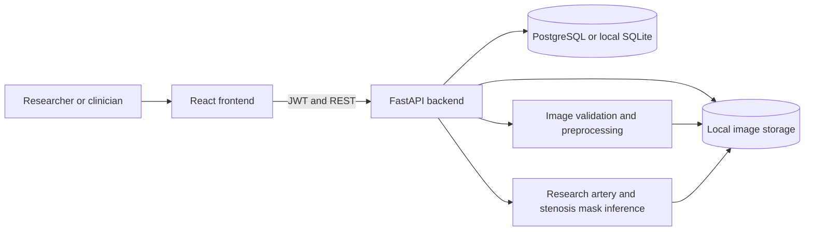

# System architecture and schema

> Historical milestone notes below contain superseded registration and admin
> scope descriptions. For the reconciled current/target contracts, use the
> [consolidated PRD](CoroVision_AI_Comprehensive_PRD_Infosys_Springboard_Team_2.md),
> [schema mapping](PRD_DATABASE_SCHEMA.md) and [API mapping](PRD_API_SPECIFICATION.md).
> Registration now grants viewer; administrators do not automatically access all cases.

The backend owns authorization and storage. The frontend never reads image
files directly; it requests a protected preview URL with a bearer token.
PostgreSQL is the target database for deployment. SQLite enables local
development without a database server.

## Database schema

| Table | Key fields | Purpose |
|---|---|---|
| users | id, email, password_hash, role | Accounts; registration grants researcher role |
| user_profiles | user_id, display_name, updated_at | Editable profile information |
| auth_sessions | id, user_id, expires_at, revoked_at | Revocable JWT sessions |
| login_throttles | user_id, failed_attempts, blocked_until | Per-account failed-login limit |
| cases | id, owner_id, case_code, patient_code, age_band, gender, medical_history, risk_factors, clinical_notes, scan_date, modality, anatomy, status | De-identified imaging cases |
| images | id, case_id, original_path, preview_path, width, height, spacing_mm, roi_box, frame_index, preprocessing_json | Uploaded study and normalized preview |
| audit_events | id, user_id, action, case_id, created_at | Login and case activity |
| analysis_runs | id, image_id, model_version, mask pixel counts, overlay_path | Stored research inference result |
| analysis_events | id, image_id, model_version, mask pixel counts, overlay_path, validation_json | Append-only analysis history |

`users 1→many cases 1→many images`. `audit_events` reference the user.
Future tables can hold reviewed lesions, model registry entries, and reports.

## API contract, milestone 1

| Method | Route | Purpose |
|---|---|---|
| GET | /api/health | Health check |
| POST | /api/auth/register | Researcher registration |
| POST | /api/auth/login | JWT login |
| GET | /api/auth/me | Current user |
| GET/POST | /api/cases | List/create cases |
| GET | /api/cases/{id} | Case details |
| POST | /api/cases/{id}/images | Validated upload |
| GET | /api/images/{id}/preview | Protected processed preview |
| POST | /api/admin/users/{id}/role | Admin-only role assignment |
| GET/PATCH | /api/auth/me | View or update profile |
| POST | /api/auth/change-password | Change password and revoke sessions |
| GET | /api/auth/sessions | Show own sessions |
| POST | /api/auth/logout | Revoke current session |
| POST | /api/auth/logout-all | Revoke every own session |
| GET | /api/auth/audit | Show own recent activity |
| GET | /api/admin/users | Admin-only user list |
| GET | /api/admin/audit | Admin-only audit history |
| GET | /api/analysis/status | Research model availability |
| POST | /api/images/{id}/analyze | Run artery and stenosis mask inference |
| GET | /api/images/{id}/analysis | Read stored research result |
| GET | /api/images/{id}/analysis/overlay | Protected mask overlay |
| PATCH | /api/cases/{id} | Update de-identified case metadata |
| GET | /api/cases/{id}/analyses | Case analysis history |
| GET | /api/images/{id}/analyses | Image analysis history |
| GET | /api/images/{id}/analyses/{run_id}/overlay | Historical protected overlay |
| GET | /api/images/{id}/analysis/compare | Compare two runs on one image |

Cases are owner-scoped; admins may view all cases. Public registration cannot
assign privileged roles. Bootstrap the first local administrator with
`backend/create_admin.py`. Production needs institution-managed role assignment,
TLS, secret management, backups, and a privacy/security review.

## Role permissions

| Role | Case access | Profile and sessions | Manage users and audit |
|---|---|---|---|
| Medical researcher | Own cases | Own account | No |
| Radiologist / clinician | Own cases | Own account | No |
| Data scientist / ML engineer | No case access in this milestone | Own account | No |
| Administrator | All cases | Own account | Yes |

Public registration always creates a researcher account. The administrator
assigns other roles. Model-development permissions for ML engineers will be
added with the model-management milestone.

JWTs contain a session ID and expire after eight hours. The backend verifies
the session is still active on every request. Password changes revoke all
sessions. Passwords are stored with bcrypt-SHA256 hashes; existing bcrypt
hashes remain verifiable. Five failed attempts on a known account cause a
15-minute account lock. Audit events record registration, successful and
failed login, profile and password changes, logout, role changes, case
creation, and image upload. This local prototype does not replace a clinical
identity provider or production security review.
