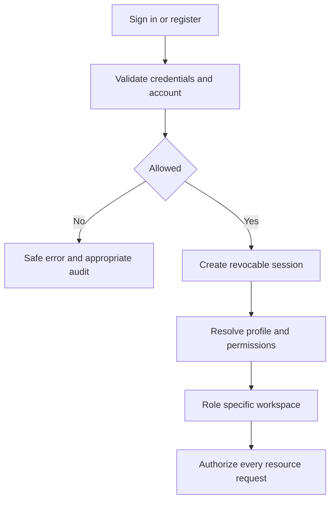
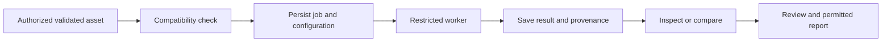

# CoroVision AI consolidated product requirements

Infosys Springboard Team 2 · 16 October 2026

## Document scope and evidence

This consolidates the supplied detailed roles, modules, workflows and updated
authentication/case requirements with the comprehensive PRD reattached on
16 October 2026. An unchanged [source snapshot](reference/CoroVision_AI_Comprehensive_PRD_supplied_2026-10-16.md)
preserves all 25 original sections, the Team 2 roster, candidate technologies,
reported observations and milestones. Embedded Mermaid CSS in the pasted material
is formatting, not application code.

The [source reconciliation](PRD_SOURCE_RECONCILIATION_2026-10-16.md) maps every
original section and identifies unresolved data/metric claims. Supplied findings
are not automatically verified repository measurements. Specific user decisions
and least-privilege runtime policy remain controlling where illustrative role
matrices or navigation suggestions differ.

Requirements below describe the target product. They are not a claim that every
module exists. Current implementation and planned work are separated in
[the implementation and acceptance plan](PRD_IMPLEMENTATION_AND_ACCEPTANCE.md).
The current stack remains React/TypeScript/Vite, FastAPI and SQLAlchemy. No new
identity provider, database or framework is introduced by this specification.

## 1 Objectives and scientific boundaries

Build an authorized research workflow connecting de-identified studies to source
assets, reproducible preparation, compatible model outputs, review and export.
Preserve dataset EDA, evaluation, stenosis localization, reports and administration
as distinct modules. Public datasets and explicitly synthetic demonstration
records are the default. Do not invent missing clinical context or outputs.

Keep 2D X-ray coronary angiography separate from 3D CT/CTA and other anatomy.
Route by modality, anatomy, task, input geometry and model compatibility. A model
approved for one dataset or task is not approved for all vascular studies.
Segmentation, candidate localization, severity estimation and clinical assessment
are different outputs. Mask area is not blood flow or vessel capacity. Physical
diameter requires defensible calibration/geometry. Severity remains unavailable
or experimental unless suitable labels and measurement validation exist.

No detection does not establish absence of disease. An empty annotation does not
establish normality. Research review approval is not clinical deployment approval.
Training remains paused until the user explicitly resumes it.

## 2 Roles and explicit permissions

The final four professional roles in the supplied update are the primary target.
Existing viewer and technician accounts are retained, not deleted or promoted.
Reviewer/supervisor maps to the clinician review workspace for now; a separate
supervisor role or multiple-role assignment needs a deliberate schema migration.
The worker is an internal service identity, never a selectable human role.

| Role | Workspace and responsibilities | Restrictions |
|---|---|---|
| Medical researcher | Authorized cases, intake, preparation, approved analysis, result history, evaluation, datasets, reports | No self-elevation, silent reference-label replacement, test-set edits or model approval |
| Radiologist or clinician | Assigned review queue, source/reference/prediction inspection, notes, comparisons and decisions | No weight editing, global protocol changes or automatic report-signing authority |
| Data scientist or ML engineer | Authorized manifests, EDA, experiments, model versions, error analysis and candidate submission | No default medical-case access, self-approval or automatic production activation |
| Administrator | Accounts, permissions, registry governance, job operations, configuration, audit and security | No default case-content access or authority to alter clinical decisions |
| Viewer | Shared case details, recorded findings, report status and actual assigned clinicians | Read only; no upload, model evaluation, engineering controls or analysis submission |
| Technician | Authorized intake, metadata and quality preparation | Analysis needs a separate grant; no clinical sign-off or model activation |
| Processing service | Assigned job inputs, approved model artefacts and required output writes | No user-role changes or unrestricted case browsing |

Every protected request checks authentication, current account status, effective
permission, resource scope, input validity and task compatibility. Browser roles,
email domains and display names are not authority. Administrative operational
grants remain separate and audited; self-granting is prohibited.

## 3 Navigation and dashboards

Use the existing shared shell with a collapsible sidebar, product logo, notification
bell and account/settings access. Preserve the user's previous decisions: no
permanent design-preview strip, no duplicated dashboard notification panel, no
role-permission hero block, and Appearance stays at the bottom of Settings.
Search, help, workspace selection and environment indicators are added only when
backed by an implemented service and a clear purpose.

| Workspace | Target navigation |
|---|---|
| Researcher | Dashboard; Cases; Data and Uploads; Analysis; Evaluation; Datasets and Experiments; Reports; Settings |
| Clinician reviewer | Review Dashboard; Assigned Review Queue; Case Review; Review History; Reports; Settings |
| ML engineer | Dataset Quality; Experiments; Evaluation; Model Registry; Settings |
| Administrator | Administration; Users and Permissions; Dataset Registry; Models; Jobs; Configuration; Audit; Security and Storage; Settings |
| Viewer | Dashboard; Assigned Cases; Profile and Settings |
| Technician | Dashboard; Case Intake; Image Inspection; permitted Reports; Settings |

These are target destinations, not evidence of separate implemented pages.
Filter navigation and returned data using server permissions. Preserve useful
search/filter state on back navigation. Use consistent headings and accessible
loading, empty, validation-error, permission-denied, not-found and network-error
states. Do not restore unwanted breadcrumbs solely for decoration.

Research dashboards answer what is running, what needs attention, what is ready,
what data problems exist and what the user can do next. Active-case counts must
have a defined open-state query; queued/running jobs must come from persistent
jobs, not inferred animation. Completed analyses must have a defined time range.
Cards link to matching filters. Recent rows show case, task, model, timestamps,
state and authorized action. Do not invent counts, percentages or metrics.

Review dashboards prioritize pending assignments, changes requested, completed
reviews and flagged quality problems. Overdue/priority labels require actual
due dates and defined rules, not unvalidated clinical urgency. Admin dashboards
show safe API/database/worker health, failures, account events, registry status
and measured storage, without exposing secrets or medical content by default.

## 4 Authentication and account lifecycle

Provide registration, password login, JWT expiry with revocable sessions, profile
management, password change/reset, logout, account status and security audit.
Public registration creates a viewer. Professional access requires an authorized
decision, not a user-selected privileged role. Document the current bearer-token
design and its storage risks; adopting HttpOnly cookies requires a deliberate
CSRF-aware migration, not a second parallel authentication system. Refresh-token
support must not be claimed unless implemented and tested.

Real institutional SSO requires an actual trusted provider, issuer/redirect
configuration and role mapping. Demo accounts are not institutional identities.
Production requirements include HTTPS, managed secrets, stronger privileged
authentication where supported, backups and security review.

## 5 Subjects and cases

Use an internal pseudonymous subject ID. Age or source-approved age group, sex or
gender terminology, acquisition date, history, risk factors and restricted notes
are optional where permitted. Preserve source terminology instead of forcing an
incompatible clinical interpretation. Do not infer history from an image. For
ordinary demonstration, sensitive history/risk/note controls should be disabled
unless a legitimate de-identified research requirement is enabled. The current
case form exposes optional coded fields; default-disable behaviour is new work.

Each case needs a stable ID, owner, authorized collaborators, subject reference
when applicable, modality, anatomy, intended task, dataset/source references,
created/updated timestamps and separate upload, preparation, analysis, review
and report state. Source/model identifiers belong to linked assets/results.
Do not force hepatic, aortic or brain data into a coronary case definition.

The list supports search, modality/anatomy/task/owner/date/status filters, sorting,
pagination and recoverable archival within scope. Details separate Overview,
Assets, Analyses, Compare Results, Reviews and Notes, History and Reports.
Reopening or refreshing must retrieve durable records rather than lose them.
Current case anatomy accepts coronary only; broad anatomy support is planned.

## 6 Uploads assets and preparation

The intake sequence is case/file selection, validation, geometry inspection,
task-specific preparation, and quality review. Display supported content types,
size limits and truthful upload/preparation progress. Validate content, not just
extension. Retain original bytes and checksums. Reject unsafe/corrupt inputs with
safe reasons and preserve correction context. Never expose arbitrary paths.

Assets distinguish source, reference annotation, derived input, prediction,
visualization and export. Asset detail shows identity, parent case, media type,
size/hash, shape, metadata, validation, processing history and linked results.
Target states include uploaded, validated, warning, rejected, quarantined,
preprocessing failed and ready. A quarantine blocks downstream use until an
authorized, evidenced resolution; this lifecycle is not yet a complete service.

Record operation input/output, parameters, outcome and software version. Preserve
available spacing/orientation/affine, update geometry after crops/resampling, and
use label-preserving interpolation for categorical masks. Missing spacing remains
unknown. Display pixels, voxels and millimetres accurately. Volume exports remain
separate from 2D intake until a durable volumetric asset service is implemented.
Standard and optional enhancement profiles retain the existing working behaviour.

## 7 Analysis jobs results and comparison

Submission selects an authorized validated asset, compatible task/model and
supported parameters. The server freezes asset, preprocessing and model versions
into a persistent job. Target states are queued, running, completed and failed;
cancelled is added only with real cancellation. Progress must be measured.
Retries preserve old attempts and use a new attempt identity. Idempotency prevents
duplicate submissions; server restarts require an explicit recovery policy.

The current inference endpoint executes synchronously; saved analysis history
is not a durable asynchronous queue. Do not label it as one. The target worker
must not inherit administrator credentials or launch training implicitly.

Viewer controls include zoom/pan/reset, independent reference/prediction layers,
opacity, legend and source/derived comparison. 3D navigation adds orientation and
slice position only for supported volumes. Predictions remain distinct from
reference ground truth. Attribution maps are not validated clinical explanations.

Comparisons require compatible input identity, task, label space and evaluation
protocol. Show model/configuration, source, preprocessing version, timestamps,
thresholds, units, reference provenance and comparability warnings. Different
predictions are not automatically accuracy improvements. Current pixel-count
comparison is narrower than the requested complete side-by-side comparison.

Stenosis candidates show region, genuine score and threshold when supported,
reference match status and review limitations. Do not fabricate lesion scores
from an unrelated mask statistic. Diameter-based narrowing requires documented
reference and lesion measurements, appropriate units and validated methodology.

## 8 Evaluation experiments datasets and EDA

Separate descriptive EDA, training, validation and final test results. Segmentation
supports defined Dice/IoU, precision/recall and suitable boundary metrics. Detection
uses a specified lesion-matching protocol, sensitivity, precision, false positives
per case and appropriate FROC. Severity metrics require valid severity labels:
MAE/RMSE/bias/agreement for regression or macro-F1, class support, confusion matrix
and calibration for classification. Do not display unavailable metrics as zero.

Every evaluation includes dataset/manifest/split, sample unit and count, class
support, metric definitions, empty-mask policy, aggregation, threshold selection,
model/preprocessing/code/environment versions, failures and independence limits.
Lock final tests against tuning. Compare versions only under disclosed protocols.
Experiments retain owner, seed, hyperparameters, checkpoints, curves and review.

Dataset registry retains source, release, licence/permitted use, modality/anatomy,
task/semantics, manifests, grouping, checksums, preparation protocol, duplicate
audits and approval. EDA covers inventory, split/label distributions, foreground
fractions, dimensions/shapes, intensity units, corruption, missing labels, geometry
and group overlap. Use readable coloured EDA charts with titles, axes, units,
legends, sample counts and explanatory captions; neutral application themes remain
consistent. The prior black-and-white report request does not prohibit EDA colour.

Store findings with affected IDs, evidence, version, status and resolution, not
only prose. Required warning types include ARCADE cross-task overlap, unresolved
DCA grouping, provisional Mendeley groups, missing CADICA grades, AortaSeg geometry
quarantine and pseudo-labels, ImageCAS/ImageCAS-X overlap, coarse resampling and
non-coronary anatomy. Supplied numbers such as 48 AortaSeg pairs and decoded-hash
counts are source assertions pending the corresponding manifest audit, not newly
verified findings. Do not manufacture a quarantine list. Preserve documented raw
hash versus decoded-pixel distinctions and COCO image IDs versus filenames.

## 9 Review reports notifications and administration

Review assignment links an authorized reviewer to a specific result version.
Review decisions are approved for specified research use, changes requested,
rejected or escalated, with identity, timestamp and comments. Preserve decisions;
corrections append history. Clinical review and final report approval are separate
permissions. Review does not silently replace annotations, weights or protocols.

Report creation selects an accessible completed result, validates completeness,
previews it, then exports and audits. Reports include report/case/asset IDs, date,
modality/anatomy/task, preparation/model/software versions, visualizations, defined
measurements/metrics, review, provenance, limitations and research disclaimer.
Evaluation reports add manifest, split, sample counts, class support and aggregation.
PDF is a target export; JSON/CSV support does not imply server-generated PDF exists.

Notifications cover genuine validation failures, completed/failed jobs, requested
reviews, decisions, reports and model-approval changes. Each needs recipient,
event, time, read state and an authorized destination. Recheck case access when
reading notifications and following links. No duplicate dashboard notification
column is required; the existing bell remains the entry point.

Administration manages accounts, separate grants, registry metadata and scoped
operations. Model approval is versioned and scoped to task/modality/anatomy and
configuration. Existing research-checkpoint activation is not that approval
workflow. Retry only supported jobs with understood causes. Audit configuration,
role, model and sensitive export changes without logging secrets. Storage/retention
and backup policies need explicit institutional approval and tested recovery.

## 10 Linked implementation contracts

- [Current and proposed API specification](PRD_API_SPECIFICATION.md)
- [Current and proposed database schema](PRD_DATABASE_SCHEMA.md)
- [File by file delivery plan and acceptance checklist](PRD_IMPLEMENTATION_AND_ACCEPTANCE.md)
- [Comprehensive source reconciliation and evidence conflicts](PRD_SOURCE_RECONCILIATION_2026-10-16.md)

## 11 Additional engine and diagnostic requirements

The source PRD sections 9–14 expand the engine targets. Segmentation must retain
available logits/probabilities, decoded labels, threshold, post-processing and
output shape, alongside immutable prediction/reference distinctions. Candidate
U-Net, U-Net++, Attention U-Net, ResUNet, DeepLabV3+, nnU-Net, 3D U-Net, TransUNet
and Swin variants are alternatives, not a requirement to train all architectures.
Classification/transformer, transfer-learning, ensemble and imbalance techniques
require suitable labels and a reproducible baseline before comparisons.

Vessel structure targets include skeleton/centerline, connected components,
continuity, branching, length, tortuosity and supported local width/cross-sectional
analysis. Each output requires method/version, units, calibration/geometry,
provenance and limitations. A saved approximate pixel width does not validate
physical diameter or a complete branching/tortuosity engine.

For missed lesions, retain original and transformed annotation overlays, raw
scores/coordinates/class IDs, threshold/NMS/filter configuration and the declared
candidate-reference matching rule. Diagnose alignment, decoding and task/checkpoint
compatibility before architecture changes. Do not tune a cutoff to make one final
test example succeed; threshold experiments use validation data and disclose
false-positive trade-offs.

The source severity categories Normal, Mild, Moderate, Severe and Critical/Very
Severe are candidate labels only. Do not invent clinical thresholds or equate
them to current clinician-entered enums. Percentage narrowing requires an
appropriate reference and lesion diameter, their measurement method and uncertainty;
absence of a validated basis means unavailable/experimental output.

Explainability may include compatible Grad-CAM/Grad-CAM++, attention or Captum
methods. Preserve a common coordinate frame for source, reference, prediction
and explanation, and label any resizing. A heatmap does not prove medically
correct reasoning. Technical model alerts must not become clinical triage.

## 12 Delivery roadmap and operational requirements

Preserve the source eight-week roadmap as a relative planning template, not
calendar commitments or evidence of completed work:

| Source milestone | Relative period | Required outcome |
|---|---|---|
| Foundation | Weeks 1–2 | Scope and manifests, EDA, architecture/schema/wireframes, authorized case/upload/preparation |
| Segmentation and vessels | Weeks 3–4 | Reproducible supported baseline, saved outputs, valid evaluation and qualified vessel measures |
| Stenosis and explanations | Weeks 5–6 | Correct localization diagnostics, suitable lesion evaluation; severity supported or explicitly blocked |
| Reporting and hardening | Weeks 7–8 | Traceable exports, comparison/versioning, end-to-end/security/performance evidence and documented demo/deployment |

The detailed Phase A–E plan remains dependency-driven. Persistent jobs and
authorization are foundation priorities; review/EDA/model registry targets may
be developed incrementally rather than waiting for an arbitrary week. The source
uses P2 both for advanced work generally and later for core registry/review, then
introduces P3. Use explicit milestone/requirement names until priority labels are
normalized; do not interpret this inconsistency as permission to skip safeguards.

Profile preprocessing, inference, API/dashboard, volume and report workloads
before setting latency/throughput targets. Do not invent timing guarantees.
Avoid unnecessarily loading full volumes in the browser. Containerization,
Docker Compose, CI and a selected deployment target require reproducible setup,
secret handling, health checks, persistent storage and backup/recovery tests.
Their presence in the source tool list does not mean they are deployed.
PACS/HIS and external medical integrations remain optional, separately reviewed
scope. No cloud provisioning, spending, new accounts or resumed training is
authorized by this documentation reconciliation.

This consolidation changes documentation only. Existing accounts, permissions,
annotations, partitions and checkpoints remain untouched.
