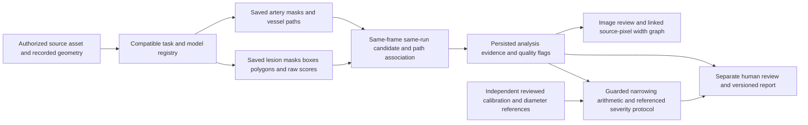

# Milestone3 stenosis architecture

5November2026 source reconciliation. This describes the existing application and actual saved evidence; it is not a new deployment or clinical-validation claim. Training is frozen by the latest supplied master checklist.

## Existing components

- `backend/app/analysis_result.py`: versioned structured evidence, explicit stages and deterministic explanation; candidate original/prepared coordinates and provenance. This is not a language-model diagnosis service.
- `backend/app/task_models.py`, `trained_release.py`, `analysis_service.py`: existing task/model interfaces. Historical remote inference verifies retained checkpoints; this does not grant local research inference permission or show that every configured app pipeline is currently ready.
- `backend/app/models.py`: existing `Case`, `Image`, `AnalysisJob`, `AnalysisRun`, `AnalysisEvent`, `ClinicalReview`, `StenosisMeasurement`, `ResearchReport` and audit entities. Reuse these; do not create a duplicate product database or authentication system. The pre-existing isolated saved-output proof database is a test fixture, not a second production persistence design.
- `candidate_path_association.py`: inactive pure coordinate v2 helper requires same run, source image and source frame. It has synthetic checks but is not silently substituted for the remote geometry producer.
- Actual same-frame geometry365636956 is generated remotely and saved with source hashes, raw masks, separate geometry masks, contours, centerlines, candidate intervals and ambiguity/no-overlap flags. Original events are not rewritten.
- `stenosis_measurements.py`/`narrowing.py`: reviewer-supplied measurements with explicit calibration/reference attestations and versioned protocol; no automatic extraction or clinical certification of those attestations.
- `frontend/src/AnalysisWorkbench.tsx`, `WidthProfileReview.tsx`, `ImagePanelGallery.tsx`: saved overlays, candidate selection/focus, ordered source-pixel width graphs/path selector, ambiguity and unavailable states. No whole-vessel interval is silently borrowed for an unassociated candidate.
- `StenosisMeasurements.tsx`, `ReviewAssessment.tsx`, `ReportsPage.tsx` and `research_reporting.py`: measurement, human assessment and report workflows remain distinct from immutable model output.

## Identity and failure contracts

Bind case, image/source hash, analysis run, model/checkpoint and preprocessing/coordinate frame. Resolve a requested saved run only from its authorized image history. A missing requested run must stay unavailable rather than silently become the latest run. Inverse transforms must include crop/padding/letterbox details; simple scaling is only valid for actual resize-only geometry. Ambiguous vessel paths stay ambiguous. A spatial path identifier is not an anatomical artery label.

No current claim is made that every candidate has a saved instance mask pixel count; missing counts display Not saved, not0. Raw model scores are not calibrated patient probabilities. Source-pixel widths are research estimates, not calibrated lumen diameters.

## Verification state

Actual combined browser proof exists for saved cases18/60; exact200case retained replay exists. Current new refresh restoration is source/synthetic-tested but browser-blocked. Full upload-to-live-model workflow, independent geometry, calibrated narrowing/severity and detector attribution faithfulness remain incomplete. No new training, backpropagation, local model loading or activation is authorized under the latest checklist.
