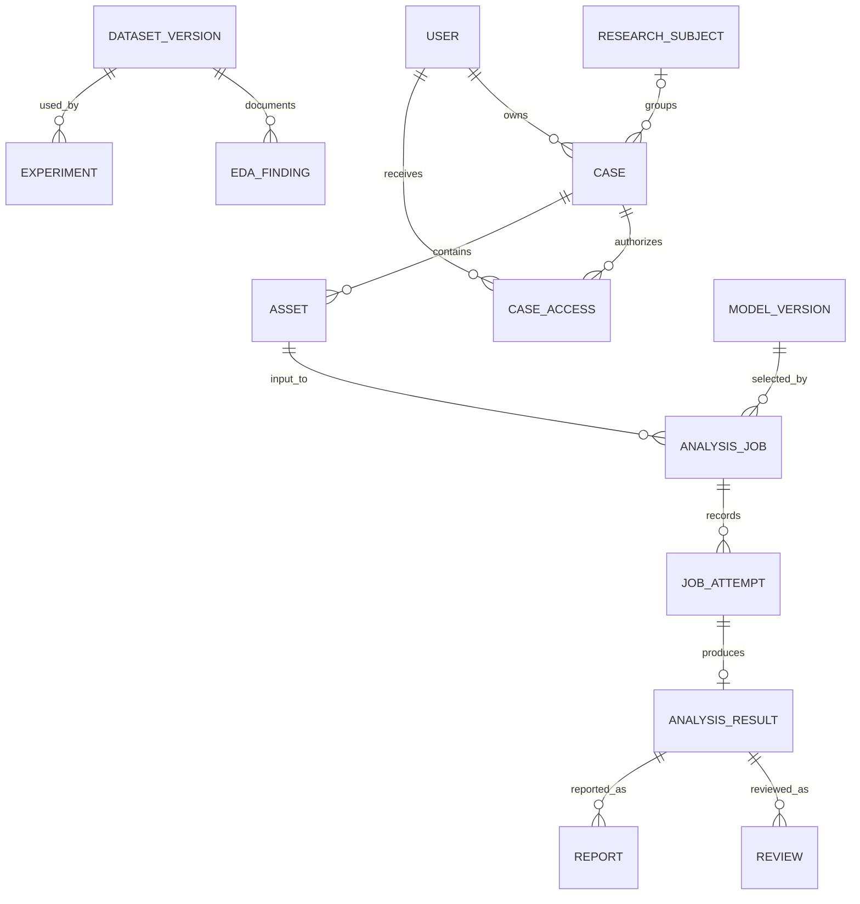

# CoroVision schema reconciliation

16 October 2026. This is a migration design, not a claim of applied migrations.
Current ORM definitions are in `backend/app/models.py`; SQLAlchemy defaults to
local SQLite through `database.py`. Preserve UUID identifiers and existing data.

## Existing entities and mapping

| Requested concept | Existing implementation | Gap |
|---|---|---|
| Users and roles | users, user_profiles, user_identities; role string and action_policy.py | Not normalized multi-role assignments |
| Session lifecycle | auth_sessions, login_throttles, one_time_codes, OAuth records | No claim of refresh-token rotation or institution MFA |
| Permissions | action_grants and role_access_requests | Scoped dataset/model grants need new contracts |
| Research subjects | Optional pseudonymous/context fields on cases | No separate research_subjects entity |
| Cases | cases and case_access | Task/source references, updated time and wider anatomy need migration |
| Assets | images | Not a general typed asset graph or persistent volume registry |
| Analysis results | analysis_runs, analysis_events | No persistent asynchronous analysis_jobs/attempts queue |
| Reviews and reports | clinical_reviews, report_revisions, case_comments | Result-specific research decisions and generated-PDF lifecycle incomplete |
| Notifications and audit | notifications, audit_events | Extend event/resource/outcome schemas as new modules arrive |
| Datasets experiments findings | Filesystem reports/manifests and scripts | Not integrated dataset/EDA database services |
| Model versions | Registry/config artefacts read by API | Full relational approval lifecycle absent |

## Target relationships

The diagram describes target cardinality. Optional subject assignment remains
valid. User-scoped dataset access is separate from medical case access.

## Proposed fields and integrity rules

- **research_subjects:** UUID, pseudonymous source-scoped ID, dataset/version,
  permitted age/sex metadata, de-identification status, created/updated time.
  Restricted history/notes stay optional and disabled in ordinary demo use.
  Do not retrospectively infer subjects from filename prefixes.
- **cases extension:** intended task, dataset/source references, optional subject
  FK, updated_at, supported anatomy. Enforce active case reference uniqueness per
  owner transactionally after checking existing collisions; do not silently
  rewrite current references. Index owner/status/time and access user/case.
- **assets:** UUID, case FK, type, source parent FK, hash/size/media type, protected
  storage key, shape, spacing/orientation/affine, validation/de-identification
  state. Derived records store configuration/version and transform provenance.
  Validate alignment without overwriting reference masks. Quarantine transitions
  require actor/reason/evidence and block downstream eligibility.
- **dataset_versions:** source/release/licence, task/semantics, modality/anatomy,
  immutable manifest/hash, split and grouping status, approval and restrictions.
  Findings link version, affected IDs, check/version, evidence, status and actor.
  Exclusions create a new version; old manifests remain auditable.
- **analysis_jobs and attempts:** case/asset/requester/model FKs, frozen task and
  configuration hash, idempotency key, state, timestamps, safe error and retry
  policy. Attempts have unique job/attempt number, worker/version and output
  references. Persist submission atomically; dispatch and recovery need a tested
  transaction/outbox strategy. Completion requires durable output metadata.
- **analysis_results:** attempt FK, predictions distinct from references,
  model/preparation/code/environment versions, thresholds, units, metric protocol,
  aggregation/sample support, output hashes and limitations. Preserve results;
  revisions create new linked records rather than altering reported history.
- **model_versions and experiments:** artefact hash, configuration, compatibility,
  provenance, manifest/split/seed, curves, approval decisions and independent
  approver. Research activation remains a separate operation.
- **reviews and reports:** result/version FK, reviewer/author, explicit decision,
  comments, timestamps and supersession link. Report generation tracks requested,
  running, completed or failed, protected file reference, frozen provenance and
  exports. Signing capability must not follow admin role automatically.
- **workspaces and user_roles:** future membership/multi-role scope only if
  required. No default expansion of existing account access during migration.

## Access retention and migration rules

Identity/session data: own-account or restricted administration. Case/subject,
asset, result, review and report data: owner/explicit assignment plus action scope.
Registry/experiment/finding data: project-specific research/ML grants. Audit is
read-restricted and append-only through supported application workflows. Worker
identity receives only assigned input/output capabilities, not user management.

No retention duration has been approved. Production rollout must define durations,
legal/approval holds, archive/purge authority, dependent artefact cleanup, backup
retention and audit preservation. Do not implement arbitrary timed deletion.

Use additive versioned migrations, a backed-up database, rollback rehearsal and
fixture verification. Existing Base.metadata.create_all is not a migration system
for changing tables. Backfill only known values; unknown subject/source/geometry
remains null or explicitly unverified. Preserve old image/result IDs and route
compatibility, then migrate callers gradually. Test SQLite and any deployment
database before claiming portability or atomic uniqueness.
